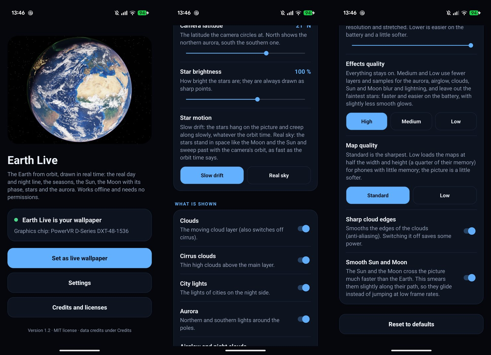

# Earth Live

A live wallpaper for Android that shows the Earth as seen from orbit, rendered in real time from the real UTC clock:
the day/night line, the seasons, the Sun, the Moon with its phase (and eclipses), the stars and the Milky Way behind it.
It works offline and asks for no permissions. A PC version for Wallpaper Engine uses the same shader.

**Get it:** [Android APK](../../releases) · [Steam Workshop (Wallpaper Engine)](https://steamcommunity.com/sharedfiles/filedetails/?id=3823825069) · free and open source (MIT)

| Phone, day | Phone, night with aurora | PC (16:9) |
|---|---|---|
|  |  |  |

**Contents:** [Features](#features) · [Install](#install-android) · [Using the app](#using-the-app) · [Performance](#performance) · [PC version](#pc-version-wallpaper-engine) · [Build](#build) · [Limitations](#known-limitations) · [License and credits](#license-and-credits)

## Features

- **Atmosphere** from precomputed light scattering (Rayleigh, Mie, ozone, multiple scattering) with real Earth parameters:
  blue limb, orange sunsets, the Sun's reddening, a lit haze over the night side.
- **Real astronomy**: Sun and Moon positions, moon phase, solar and lunar eclipses, about 870,000 catalog stars with
  their colours, the Milky Way, zodiacal light and gegenschein.
- **Ground**: the Blue Marble of the current month (snow line and vegetation follow the calendar), city lights at night,
  specular sea, relief on the clouds, a drifting 8k cloud layer, thin cirrus.
- **Upper atmosphere**: aurora (curtains along the geomagnetic ovals, both poles), airglow, noctilucent clouds,
  subtle lightning in night storms.
- **Camera**: circles the Earth at a fixed latitude (21.4 N by default) in 24 minutes, so the surface slowly turns
  under it; the Earth fills 92 % of the screen width.
- **Frugal by design**: a fixed low frame rate (10 fps by default), nothing runs while the screen is off, stars as point
  sprites, a compact half-float render target (R11G11B10F), precomputed tables, textures memory-mapped from the APK.

## Install (Android)

Download the APK from the [Releases](../../releases) page, install it, open **Earth Live** and press
**Set as live wallpaper** (or: long-press the home screen > Wallpapers & style > Live wallpapers > Earth Live).

- Requirements: Android 8.0 or newer (API 26), OpenGL ES 3.0, ASTC texture support, a GPU with 8192 px textures.
  The start page checks this and tells you if your device is not supported.
- The APK is about 154 MB (the textures are most of it).
- The APK on the Releases page is a release build signed with the author's own key (certificate SHA-256
  `13:C8:85:B7:08:49:59:85:39:62:8F:5F:E7:CA:6C:73:B5:75:6B:DF:EB:1F:7C:4B:A3:C9:E5:20:82:80:D9:1C`, check it with
  `apksigner verify --print-certs`). Android still asks you to allow installing apps from this source, as for every APK
  that does not come from a store.
- **It has only been tested on a Google Pixel 10 Pro.** Weaker GPUs may not hold the frame rate; see [Performance](#performance).

## Using the app

The start page shows whether your device can run Earth Live, whether it is currently your wallpaper, and the last start
error if the picture could not be drawn. **Settings** are also reachable from the wallpaper picker; every change applies at
once to a running wallpaper.



| Setting | Range | Default | What it does |
|---|---|---|---|
| Earth size | 70-100 % | 92 % | share of the screen width the Earth fills |
| Orbit time | 6-120 min | 24 min | time the camera needs for one lap; also how fast the Sun and Moon cross the picture |
| Direction of the Earth's turning | left to right / right to left | left to right | which way the surface moves (the real Earth turns left to right as seen here) |
| Camera latitude | 60 S to 60 N | 21.4 N | where the camera circles; north shows the northern aurora, south the southern one |
| Star brightness | 25-150 % | 100 % | brightness of the stars (they stay sharp points) |
| Clouds, cirrus, city lights, aurora, airglow and night clouds, lightning | on / off | on | switch parts of the picture |
| Lightning frequency | 25-500 % | 100 % | how often the night storms flash (only while lightning is on) |
| Cloud speed | 0-300 % | 100 % | 100 % = once around the Earth in an hour, 0 % = still |
| Cloud direction | east / west | east | real clouds mostly drift east |
| Frame rate | 5 / 10 / 20 / 30 fps | 10 fps | smoother motion costs power |
| Render resolution | 50-100 % | 100 % | the picture is drawn smaller and stretched; stars keep their size |
| Sharp cloud edges | on / off | on | anti-aliasing of the cloud edges |
| Smooth Sun and Moon | on / off | on | smears them along their path so they glide at low frame rates |

## Performance

The numbers below were measured on one phone and one PC in October 2026. They show the order of magnitude, not a guarantee
for other devices. Frame times are GPU time per frame (`glFinish` after drawing), median of 80 rounds per scene.

### Phone: Google Pixel 10 Pro

Display 1280 x 2856 (LTPO, 120 Hz), GPU PowerVR D-Series DXT-48-1536, debug build, default settings, wallpaper visible.

| | Result |
|---|---|
| GPU time per frame, everything on | **about 25 ms** in a busy loop (23-27 ms depending on the scene); 25-30 ms measured during normal operation |
| Frame budget at 10 fps / 20 fps / 30 fps | 100 ms / 50 ms / 33 ms |
| So the GPU is busy about | **23-30 % at 10 fps**, 45-60 % at 20 fps, 70-90 % at 30 fps (hot and power hungry) |
| Cheapest picture (planet and sky only) | about 10 ms |
| Frame pacing at 10 fps | 100 ms, with up to +-8 ms jitter (one vsync at 120 Hz) |
| Memory | about 250 MB (PSS), of which about 170 MB are GPU textures |
| Battery | not measured precisely; a rough early test showed the whole phone drawing about 100 mA more with everything on than with a minimal picture (noisy, +-45 mA) |

<details>
<summary>Cost of each feature (average over four scenes, ms per frame saved when it is switched off)</summary>

| Feature switched off | Saves |
|---|---|
| Clouds (main layer, cirrus and cloud detail) | 5.3 ms |
| Sun and Moon (includes the motion blur) | 2.9 ms |
| Aurora | 2.9 ms |
| Stars (sprites) | 1.4 ms |
| Anti-aliasing of the cloud edges (1 tap instead of 4) | 1.2 ms |
| City lights (with their glow) | 1.4 ms |
| Atmosphere in front of the planet | 1.8 ms |
| Atmosphere behind the planet | 1.4 ms |
| Airglow and noctilucent clouds | 0.8 ms |
| Cloud relief | 0.8 ms |
| Milky Way | 0.8 ms |
| Lightning | 0.2 ms |
| **Everything except the planet and sky** | **14.6 ms** (from 24.8 to 10.2 ms) |

The four scenes were: day over Europe, night with aurora and the Sun in view, the Moon in view, and the Pacific. The values do
not add up (features overlap) and are accurate to about +-1 ms.
</details>

<details>
<summary>What the settings did in tests</summary>

- **Frame rate** scales the GPU load linearly: halving it halves the number of frames the GPU has to draw.
- **Render resolution 50 %** took the frame from 25.2 to 23.0 ms at 5 fps. The saving looks small because at that load the
  GPU clocks down; it should help more on a GPU that is pixel-bound. Not measured on other devices.
- Frame time after the motion blur of the Sun and Moon was added stayed at about 22-23 ms (median 29.6 ms in a live run).
</details>

### PC: Intel Arc B580

2560 x 1440, Chromium WebGL2, GPU time per frame with `glFinish`-style readback: **1.6-1.9 ms**, so at 30 fps the card is
busy about 5 % of the time. This was measured in a browser, not inside Wallpaper Engine.

#### PC at other resolutions

The picture covers the same field of view at any resolution (the Earth fills 90 % of the screen height), so 1080p, 1440p and 4K
show the same scene, only sharper; stars keep their size and brightness relative to the screen. Ultrawide screens show more sky
at the sides; a screen taller than wide fits the Earth to the width. GPU time per frame on the Intel Arc B580 (browser,
`?bench=1`): **1920 x 1080: 1.3 ms, 2560 x 1440: 1.6-1.9 ms, 3440 x 1440: 2.2 ms, 3840 x 2160: 3.3 ms**. The "Render resolution"
property lowers the cost (below 100 %) or supersamples for sharper stars and edges (up to 200 % in the PC version: 2560 x 1440 at
200 % took 6.9 ms).

### How to measure it yourself

Debug builds (not the release APK) read control files from the app's files directory (see [tools/README.md](tools/README.md)). Run

```
adb shell "run-as com.example.earthlive sh -c 'echo 1 > files/profile.flag'"
```

with the wallpaper visible; the results appear in `adb logcat -s EarthWallpaper` as `PROFILE |` lines (about two minutes).
`tools/scripts/table.py` formats them. For the PC version open the page with `?bench=1` and read the page title.

Limits of these numbers: one device each, debug build, busy-loop timing (no display sync), no thermal throttling, no battery
measurement over hours. Please open an issue with your device and frame times if you test another one.

## PC version (Wallpaper Engine)

**Easiest: subscribe on the [Steam Workshop](https://steamcommunity.com/sharedfiles/filedetails/?id=3823825069).**

Or by hand: download `earth-live-pc.zip` from the [Releases](../../releases) page and extract it to
`Wallpaper Engine\projects\myprojects\earth-live-pc` (so that `project.json` lies directly in that folder), then pick it under
"Installed".

Every setting of the Android app is a Wallpaper Engine property too: Earth size, orbit time and direction, camera latitude,
star brightness, lightning frequency, cloud speed and direction, a switch for every effect, frame rate (30 by default), render resolution, sharp
cloud edges and smoothing of the Sun and Moon. The picture adapts to the screen: 1080p to 4K, ultrawide, and screens that are
taller than wide.

It also runs in any WebGL2 browser (`python tools/web_server.py`, then open http://127.0.0.1:8791). It has been tried on one
PC (Intel Arc B580) and not for hours; its performance numbers above were measured in a browser. To rebuild `web/assets`
yourself run `python tools/make_web.py` (needs the intermediate textures from the tools below).

## Build

```
./gradlew testDebugUnitTest assembleDebug     # JDK 17, Android SDK 35
./gradlew assembleRelease                     # unsigned unless keystore.properties exists (see app/build.gradle.kts)
```

The converted textures are in the repo (`app/src/main/assets`, about 150 MB), so the build does not need the raw sources.
Update a running wallpaper with `adb install -r`; do not restart it with `am force-stop`, that resets the system wallpaper.

`tools/README.md` describes the sources, the scripts that turn them into textures, star tables and atmosphere tables, the
desktop preview (`tools/preview.py`) and the debug and profiling controls. The raw sources (about 780 MB) are not in the repo.

| Folder | Content |
|---|---|
| `app/` | the Android app: `earth.frag` (the whole picture), renderer, wallpaper service, start page, settings, credits; astronomy in Kotlin with unit tests |
| `web/` | the PC version: `astro.js` (same math as the Kotlin code), `main.js` (WebGL2 renderer) |
| `tools/` | data pipeline, preview renderer, measurement scripts |

## Known limitations

- Tested on one phone (Pixel 10 Pro) and one PC (Intel Arc B580). Other GPUs, drivers, Android versions and Wallpaper Engine
  setups are untested; please open an issue with your device and what you see.
- No automatic quality levels and no battery saver mode yet; use the frame rate and render resolution settings.
- The Sun and Moon cross the picture faster than the Earth turns (they are fixed in space while the camera circles), which can
  look jerky at 5-10 fps; the smoothing option and a longer orbit time reduce this.
- The southern aurora is hard to see from the default latitude (the oval lies beyond the south limb); set the latitude lower.
- The Moon texture's origin (public domain or not) and the Gaia and GEBCO terms limit commercial use: the app is free, without
  ads, price or donation links (see [ATTRIBUTION.md](ATTRIBUTION.md)).

## License and credits

Code, shaders and scripts: MIT (`LICENSE`). The data files keep the terms of their sources: NASA imagery (credit required, no
implied endorsement), GEBCO (acknowledge the source), Solar System Scope clouds (CC BY 4.0) and the AT-HYG star table
(CC BY-SA 4.0). The exact credit lines, the terms and a list of what was changed are in [ATTRIBUTION.md](ATTRIBUTION.md); the
app shows them under "Credits and licenses".

Imagery credits: NASA Earth Observatory (Blue Marble: Next Generation, Reto Stöckli; Night Lights 2012, Robert Simmon, Suomi
NPP VIIRS data courtesy of Chris Elvidge, NOAA NGDC), GEBCO, NASA Scientific Visualization Studio (LRO Moon map, Deep Star Maps
2020 with Gaia DR2 ESA/Gaia/DPAC), Solar System Scope (clouds, CC BY 4.0), AT-HYG (stars, CC BY-SA 4.0).
This project is not endorsed by NASA, ESA, GEBCO or any other source.

**Free use only for now:** ESA's Gaia data (in the star table and the Milky Way map) are published as CC BY-NC 3.0 IGO, and the
GEBCO_08 relief data have non-commercial terms of their own. See ATTRIBUTION.md before any commercial or store release.
