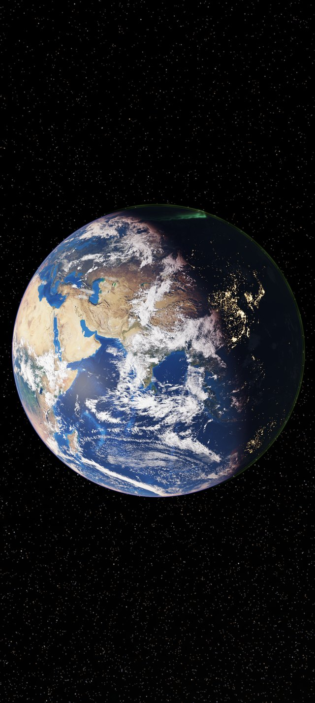
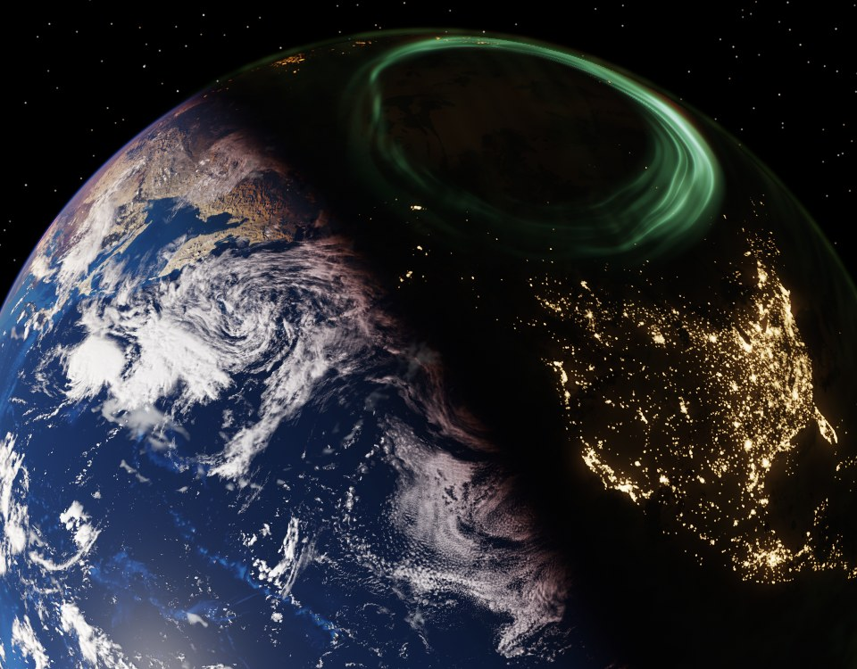
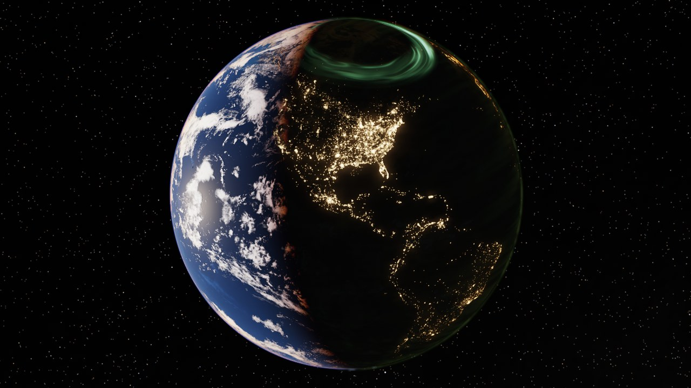

# Earth Live

A live wallpaper for Android that shows the Earth as seen from orbit, rendered in real time from the real UTC clock:
the day/night line, the seasons, the Sun, the Moon with its phase (and eclipses), the stars and the Milky Way behind it.
It needs no internet and no permissions. A PC version (Wallpaper Engine / any WebGL2 browser) uses the same shader.

| Phone, day | Phone, night with aurora | PC (16:9) |
|---|---|---|
|  |  |  |

## What is in the picture

- **Atmosphere** from precomputed light scattering (Rayleigh, Mie, ozone, multiple scattering) with real Earth parameters:
  blue limb, orange sunsets, the Sun's reddening, a lit haze above the night side.
- **Real astronomy**: Sun and Moon positions, moon phase, solar and lunar eclipses, about 870,000 catalog stars with
  their colours, the Milky Way, zodiacal light and gegenschein.
- **Ground**: monthly Blue Marble (snow line and vegetation follow the calendar), city lights at night, specular sea,
  terrain relief on the clouds, a slowly drifting 8k cloud layer, thin cirrus.
- **Upper atmosphere**: aurora (curtains along the geomagnetic ovals, both poles), airglow, noctilucent clouds,
  subtle lightning in night storms.
- **Camera** circles the Earth at 21.4 N in 24 minutes; the Earth fills 92 % of the screen width.
- **Cheap on the battery by design**: one fixed 10 fps, nothing runs while the screen is off, stars as point sprites,
  a half-float render target (R11G11B10F), precomputed tables.

## Install (Android)

Download the APK from the [Releases](../../releases) page, install it, then long-press the home screen
> Wallpapers & style > Live wallpapers > Earth Live.

Requirements: Android 8.0+ (API 26), OpenGL ES 3.0 and ASTC texture support (most current phones).
**It has only been tested on a Google Pixel 10 Pro** (about 31 ms per frame there at 1280x2856, so about 30 % GPU load
at 10 fps). Weaker GPUs may not hold 10 fps and will use more battery; there is no quality setting yet.
The APK on the Releases page is a debug-signed build (it contains the profiling controls described in tools/README.md), so Android may warn about an unknown source.

Open **Earth Live** from the app drawer: the start page checks that your GPU can run it (OpenGL ES 3.0, ASTC textures,
8k textures), sets the wallpaper, and opens the **Settings** (Earth size, orbit time, camera latitude, star brightness, cloud speed (in %) and direction,
direction of the Earth's turning, frame rate 5/10/20/30, render resolution, sharp cloud edges, and switches for clouds, cirrus, city lights, aurora, airglow and
lightning; changes apply at once) and the **Credits**. If the picture ever fails
to start, the start page shows the reason.

## Build (Android)

```
./gradlew testDebugUnitTest assembleDebug     # JDK 17, Android SDK 35
```

The converted textures are in the repo (`app/src/main/assets`, about 150 MB), so the build does not need the sources.
Update a running wallpaper with `adb install -r`; do not restart it with `am force-stop`, that resets the system wallpaper.

## PC version (Wallpaper Engine)

Download `earth-live-pc.zip` from the Releases page and extract it to
`Wallpaper Engine\projects\myprojects\earth-live-pc` (so that `project.json` lies directly in that folder), then pick it
under "Installed". Properties: frame rate (30), render scale, Earth size.
It also runs in any WebGL2 browser (`python tools/web_server.py`, then open http://127.0.0.1:8791).
Not tested on a real Wallpaper Engine other than loading the project; measured about 2 ms per frame at 2560x1440 on an Intel Arc B580.
To rebuild `web/assets` yourself run `python tools/make_web.py` (needs the intermediate textures from the tools below).

## Rebuilding the data

`tools/README.md` describes the sources, the scripts that turn them into textures, star tables and atmosphere tables,
the desktop preview (`tools/preview.py`) and the debug/profiling controls. The raw sources (about 780 MB) are not in the repo.

## Layout

| | |
|---|---|
| `app/` | the Android app: `earth.frag` (the whole picture), `EarthRenderer.kt`, `EarthWallpaperService.kt`, astronomy in Kotlin with unit tests |
| `web/` | the PC version: `astro.js` (same math as the Kotlin code), `main.js` (WebGL2 renderer) |
| `tools/` | data pipeline, preview renderer, measurement scripts |

## License and credits

Code, shaders and scripts: MIT (`LICENSE`). The data files keep the terms of their sources: NASA imagery (credit required, no
implied endorsement), GEBCO (acknowledge the source), Solar System Scope clouds (CC BY 4.0) and the AT-HYG star table
(CC BY-SA 4.0). The exact credit lines, the terms and a list of what was changed are in [ATTRIBUTION.md](ATTRIBUTION.md).

Imagery credits: NASA Earth Observatory (Blue Marble: Next Generation, Reto Stöckli and Robert Simmon; Black Marble 2012, Robert
Simmon, Suomi NPP VIIRS data courtesy of Chris Elvidge, NOAA NGDC), GEBCO, NASA Scientific Visualization Studio (LRO Moon map,
Deep Star Maps 2020 with Gaia DR2 ESA/Gaia/DPAC), Solar System Scope (clouds, CC BY 4.0), AT-HYG (stars, CC BY-SA 4.0).
This project is not endorsed by NASA, ESA, GEBCO or any other source.

**Non-commercial use only for now:** ESA's Gaia data (in the star table and the Milky Way map) are published as CC BY-NC 3.0 IGO,
and the GEBCO_08 relief data have non-commercial terms of their own. The project is therefore free, without ads, prices or
donation links. See ATTRIBUTION.md before any commercial or store release.
